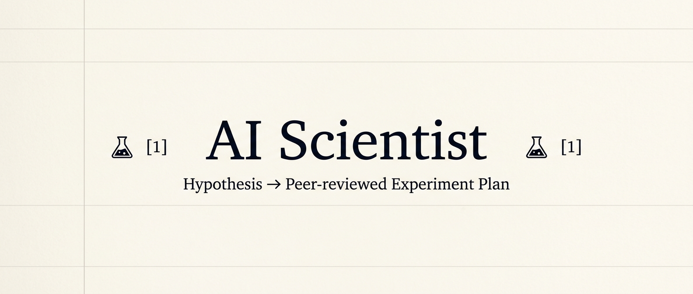

<div align="center">



# AI Scientist

**Turn a natural-language scientific hypothesis into a fully-costed,
peer-reviewed experiment plan — backed by real literature, deterministic
safety/feasibility checks, and a structured AI critique.**

[](./RUNNING.md)
[](./LICENSE)
[](./.github/workflows/ci.yml)
[](https://lovable.dev)
[](./CONTRIBUTING.md)

[**Run it locally**](./RUNNING.md) ·
[**Report a bug**](https://github.com/gopalinternship-unibasel/ai-scientist/issues/new?template=bug_report.yml) ·
[**Request a feature**](https://github.com/gopalinternship-unibasel/ai-scientist/issues/new?template=feature_request.yml) ·
[**Contributing**](./CONTRIBUTING.md)

</div>

> **The hosted demo is offline.** It ran on a Lovable Cloud project that no
> longer exists, so `ai-scientist.lovable.app` no longer works.
> [`RUNNING.md`](./RUNNING.md) runs the whole system on one PC (local
> Supabase stack, local or hosted model).

---

## ✨ What it does

You type a hypothesis like:

> *"CRISPR-Cas9 knockout of sox2 in axolotl limb blastema cells will reduce
> regeneration rate by ≥50% compared to wild-type controls over 28 days."*

…and the system streams back, in **~60–90 seconds** on the hosted models
(a CPU-only local model takes far longer; see [`RUNNING.md`](./RUNNING.md)):

| Stage | Output |
|---|---|
| 🔍 **Literature QC** | Parallel search across Semantic Scholar, OpenAlex & PubMed. Classifies as `exact_match` / `similar` / `not_found`. The reference list holds only papers the search returned; a protocol step's source is shown only when it is one of them (model-written URLs, DOIs and author-year citations are removed). |
| 🧪 **Experiment plan** | Title, summary, success criteria, step-by-step protocol with citations, materials with suppliers and catalog numbers (each marked verified only when a catalogue confirmed it: Sigma-Aldrich through PubChem, common ATCC cell lines, a short product list; every other number is shown as unverified, and wrong or placeholder numbers are removed), itemised budget, timeline, statistical design, validation, safety, risks, team. |
| 🧐 **Reviewer critique** | Strengths, concerns (with severity), missing controls, statistical notes, ethical notes, overall score. |

Every plan is **exportable to PDF**, **shareable** via a public link, and
**refinable** through natural-language follow-ups (*"add a vehicle control"*,
*"swap to ICR mice"*, *"halve the budget"*) — producing a new versioned plan
linked to the parent.

## 🛡️ Why it doesn't hallucinate (much)

Generic LLMs happily invent fake citations, impossible reagents, and plans
for experiments that violate physics. We layer **deterministic guards
outside the LLM**, before and after the plan is generated:

| Guard | Where | Catches |
|---|---|---|
| **Hypothesis gate** | `_shared/hypothesisGate.ts` | Vague goals (`"improve cancer treatment"`), non-scientific input (`"my cat likes tuna"`), instructions to the AI, gibberish. Runs as the first step of the run: the run fails with a `VALIDATION` error and a suggested rewrite. |
| **Feasibility check** | `_shared/feasibilityCheck.ts` | Hard physical/biological impossibilities — Abbe diffraction limit, FTL signalling, perpetual motion, absolute zero, **cryogenic exposure of living vertebrates**, no-communication theorem. Pure regex, fast and free. |
| **Safety screen** | `_shared/safety.ts` | Human/animal subjects, BSL ≥2, controlled substances, recombinant DNA, hazardous chemicals — feeds requirements into the planning prompt. |
| **Catalog numbers** | `_shared/catalogCheck.ts`, `skuVerify.ts` | Supplier-specific catalog-number formats (Sigma `A1234-5G`, Thermo 7–9 digits, etc.), a canonical SKU dictionary and a live lookup of Sigma-Aldrich SKUs in PubChem. A number that belongs to another product or breaks the format is removed before the plan is saved, with a note on the material. |
| **Citation sanitiser** | `_shared/citations.ts` | Strips out-of-range or malformed `[N]` references in protocol steps and reports the count of hallucinated/rewritten/valid citations. |
| **Source check** | `_shared/planIntegrity.ts` | A protocol step's `source` must be one of the retrieved references (matched by `[N]`, URL, DOI or title); anything else that looks like a citation is removed, also from step text. The plan view and the PDF apply the same check to older plans. |
| **Budget arithmetic** | `_shared/planIntegrity.ts` | A materials line below the materials table subtotal is raised to it, and the total is set to the sum of the budget line items (the model's own total disagreed in every local plan). |
| **Plan guards** | `_shared/planGuards.ts`, `planContentChecks.ts` | Flags materials that leave out what the hypothesis is about (its cell line, compound, measurands) or are copied from cost-catalog topics it does not mention, protocol doses that differ from the hypothesis' dose, protocol steps that only list materials, protocol steps longer than the timeline, and refinements whose budget or timeline limit ("under $3,000", "8 weeks") the new plan breaks. A high-severity finding gets one automatic second attempt. House rules unrelated to the hypothesis are kept out of the prompt, and the catalog shows only the topic groups that fit. Findings are stored on the plan, shown under "Automated checks" and sent to the reviewer. |
| **Literature queries** | `_shared/queryDegradation.ts`, `hypothesisTerms.ts` | Besides the full hypothesis, each source gets keyword queries built from the hypothesis' weighted concepts (cell line, compound, acronyms, topic), from the 5 heaviest down to 2, and the candidates are ranked by how much of the hypothesis they cover. |
| **Novelty verdict check** | `_shared/noveltyVerdict.ts` | Corrects the AI classifier when it contradicts the retrieved papers: "not found" with on-topic papers becomes "similar", "exact match" without a paper that names the hypothesis' core is downgraded, and off-topic papers are not shown as references. Textbook-technique "exact match" applies only to protocol requests, not to claims that use the technique as a readout or comparator. |

The plan and its critique are also generated by **two independent AI calls**
so the reviewer can flag the planner's mistakes (and we feed deterministic
catalog issues into the reviewer as extra context).

## 🏗️ Architecture

> **Deep dive:** see [`docs/ARCHITECTURE.md`](./docs/ARCHITECTURE.md) for the
> full technical reference — request lifecycle, edge-function pipeline,
> deterministic guards, literature search, LLM fallback, data model,
> realtime/sync, feedback loop, security model, and operational concerns —
> with Mermaid diagrams for each.

```
┌──────────────────────────────────────────────────────────────────────┐
│  Browser (React 18 + Vite + Tailwind + shadcn/ui)                    │
│  └── HypothesisInput → SSE stream → RunPage (live progress)          │
└──────────────────────────────────────────────────────────────────────┘
                                │  POST /run-experiment (SSE)
                                ▼
┌──────────────────────────────────────────────────────────────────────┐
│  Supabase Edge Function: run-experiment (Deno)                       │
│                                                                      │
│  Stage                        Model (primary → fallback)             │
│  ─────────────────────────────────────────────────────────────────   │
│  1. hypothesisGate            gemini-2.5-flash-lite → gpt-5-nano     │
│  2. feasibilityCheck          deterministic (regex rules)            │
│  3. rate-limit                100 / hr (anon by IP, signed-in by uid)│
│  4. cache lookup              same hypothesis + pipeline version     │
│  5. literature search         S2 + OpenAlex + PubMed (parallel),     │
│                               word ranking + embedding filter        │
│  6. novelty classify          gemini-3-flash-preview → gpt-5-nano    │
│  7. safety screen             deterministic (prompt fragment)        │
│  8. plan generation (SSE)     gemini-3-flash-preview → gpt-5-mini    │
│  9. citation sanitise         deterministic (strip out-of-range)     │
│ 10. plan guards + SKU check   deterministic (Sigma SKUs via PubChem) │
│ 11. critique pass             gpt-5-mini → gemini-3-flash-preview    │
└──────────────────────────────────────────────────────────────────────┘
                                │
                                ▼
┌──────────────────────────────────────────────────────────────────────┐
│  Lovable Cloud (Postgres + Realtime + Auth)                          │
│  ├── runs           — hypothesis, qc, plan, critique, status, version│
│  ├── plan_feedback  — section-level corrections + pgvector embeddings│
│  ├── domain_rules   — distilled house rules per domain               │
│  └── rate_limits    — sliding-window counter                         │
└──────────────────────────────────────────────────────────────────────┘

Offline / background jobs
┌──────────────────────────────────────────────────────────────────────┐
│  distill-house-rules (Admin)  gpt-5-mini                             │
│      └─ converts trusted corrections → durable per-domain rules      │
│  eval-harness (A/B + judge)   planner: gemini-3-flash-preview        │
│                               judge:   gpt-5  (cross-family →        │
│                                        uncorrelated scoring errors)  │
│  embed-feedback               text-embedding-004 (768d, cosine)      │
└──────────────────────────────────────────────────────────────────────┘
```

**Why this routing?** Three principles: (1) **hot path → Gemini Flash** for
latency + long context + cheap streaming; (2) **reasoning-critical → GPT-5-mini**
for the critic and rule distillation, where one extra caught flaw compounds
across every future plan in that domain; (3) **every chain has a cross-family
fallback** — if one provider degrades, the pipeline keeps producing plans
instead of 500-ing.

### Tech stack

- **Frontend** — React 18, Vite 5, TypeScript 5, Tailwind 3, shadcn/ui,
  TanStack Query, React Router, sonner, jsPDF.
- **Backend** — Supabase Edge Functions (Deno), Postgres with RLS,
  Supabase Realtime for live run updates, pgvector for feedback retrieval.
- **AI** — any OpenAI-compatible endpoint, configured by env
  (`supabase/functions/_shared/aiProvider.ts`; local Ollama by default, see
  RUNNING.md). The original hosted setup used the Lovable AI Gateway, routed
  per stage:
  - Hot path (planner, novelty): `google/gemini-3-flash-preview` —
    long context + fast streamed structured output, fallback to
    `openai/gpt-5-mini`.
  - Reasoning-critical (critic, house-rules distillation):
    `openai/gpt-5-mini` — sharper at methodological flaws, fallback to
    `gemini-3-flash-preview`.
  - Eval judge: `openai/gpt-5` — different family from planner so
    judge errors are uncorrelated with planner errors (tighter eval CIs).
  - Cheap classifiers (gate, domain normalize): `google/gemini-2.5-flash-lite`
    with cross-family `gpt-5-nano` fallback for jailbreak resistance.
  - Embeddings: Gemini `text-embedding-004` (768d, cosine).
  **No user-supplied API keys required.**
- **Literature** — Semantic Scholar Graph API, OpenAlex
  (`title_and_abstract.search`), PubMed E-utilities — best-effort,
  deduplicated by DOI then by normalised title prefix.
- **Tests** — Vitest (frontend) + Deno test runner (edge functions).

## 🚀 Quick start

> **Self-hosted (current):** the original Lovable Cloud project is gone. To
> run the whole system on one PC (local Supabase in Docker, edge functions,
> frontend on http://localhost:5180, local Ollama or any OpenAI-compatible
> provider), follow [`RUNNING.md`](./RUNNING.md).

You'll need [Bun](https://bun.sh) (or npm) and a Lovable Cloud project.

```bash
git clone https://github.com/gopalinternship-unibasel/ai-scientist.git
cd ai-scientist
bun install
bun run dev          # Vite dev server on :8080
bun run test         # Vitest (frontend + lib); plain `bun test` is Bun's own runner
bun run build        # production build
```

`.env` is auto-managed by Lovable Cloud and contains:

```
VITE_SUPABASE_URL=...
VITE_SUPABASE_PUBLISHABLE_KEY=...
VITE_SUPABASE_PROJECT_ID=...
```

### Edge function tests (Deno)

```bash
deno test --allow-net --allow-env --allow-read --no-lock supabase/functions/_shared/ supabase/functions/run-experiment/
```

## 📁 Project structure

```
src/
├── pages/                       # Index, RunPage, MyRuns, Auth, Admin, …
├── components/                  # HypothesisInput, GenerationProgress,
│                                # LiteratureQCCard, ExperimentPlanView,
│                                # PlanCritiqueCard, RefineDialog, …
├── lib/                         # runStream (SSE), citations, exportPdf, …
└── integrations/supabase/       # Auto-generated client + types

supabase/
├── functions/
│   ├── run-experiment/          # Main SSE endpoint
│   ├── distill-house-rules/     # Background lesson distillation
│   ├── embed-feedback/          # pgvector embedding pipeline
│   ├── eval-harness/            # Offline regression scoring
│   └── _shared/                 # Pure logic — the deterministic guards
└── migrations/                  # Schema, RLS, helper SQL functions
```

## 🗄️ Data model (highlights)

**`runs`** — one row per generation. Stores hypothesis, SHA-256 hash of the
hypothesis and the pipeline version (cache key; runs made by an older
pipeline are never replayed), status (`pending` → `qc` → `plan` → `done` / `failed`), QC, plan,
critique, version, parent (for refinements), owner (anon token or user id),
and a lazily-generated share token.

**`plan_feedback`** — section-level corrections from users, embedded with
pgvector, deduplicated, and retrieved on future runs in the same domain to
nudge the planner.

**`domain_rules`** — distilled house rules per scientific domain, made from
accumulated feedback when a moderator runs `distill-house-rules` (Admin page
or a call to the function). No schedule runs it: the only pg_cron jobs are
`cleanup-stale-runs` and `cleanup-old-rate-limits`.

**`rate_limits`** — sliding-window counter, 100 req/hour per `(identifier,
kind)`.

### Row-level security

- Anon viewers can read a run via `owner_token` (browser-local, runs no
  account owns) or the run's `share_token`; signed-in viewers read their own
  runs and any run they hold a share link for.
- Clients cannot insert, update or delete runs, except the owner setting
  `share_token` (the Share button). The edge function writes QC, plan and
  critique with the service role.
- Feedback: owners insert their own rows and may edit only `rating` and
  `correction`; moderation (`hidden`) goes through `set_feedback_hidden()`,
  and ranking columns (`dup_count`, uplift counters, `embedding`) are
  server-written.
- The similarity search over everyone's corrections (`match_plan_feedback`)
  and the other server helpers are executable by the service role only.
- Anon runs created before sign-in are claimed via `claim_anonymous_runs(token)`.

## ✅ Edge cases — verified behaviour

| Input | Result |
|---|---|
| `"improve cancer treatment"` | Run fails at the hypothesis gate (`VALIDATION`) — vague; suggestion returned |
| `"My cat likes tuna fish."` | Run fails at the hypothesis gate (`VALIDATION`) — non-scientific |
| Resolve atoms with brightfield optical microscopy | 400 — Abbe diffraction limit |
| Cool zebrafish to 4 K in liquid helium | 400 — cryogenic-vertebrate rule |
| Standard PCR / Western blot / ELISA protocol | `exact_match` literature, full plan |
| Highly novel composite material hypothesis | `not_found` — **0 references**, plan still generated with honesty about novelty |
| Same hypothesis submitted twice | Cache hit — `cached:true`, identical plan (only from a run of the current pipeline version) |

## 🔒 Security

- All SQL operations use the Supabase typed client — no raw SQL from the client.
- RLS is enabled on every table; service-role access is restricted to the
  edge function.
- Anon `owner_token` is a high-entropy random string, validated server-side.
- No secrets are exposed to the browser; the Lovable AI Gateway key lives
  only in the edge function's environment.

Found a security issue? See [`SECURITY.md`](./SECURITY.md) — please report
privately.

## ⚠️ Limitations

- **Plan quality scales with hypothesis specificity.** Generic prompts get
  generic plans.
- **Catalog numbers should still be verified before ordering.** The
  cross-check covers ~7 major suppliers and known-canonical SKUs; novel
  reagents are marked `"Custom"` rather than fabricated.
- **Cost estimates are list-price approximations**, not procurement quotes.
- **Literature recall depends on three external APIs.** When all three are
  rate-limited, QC degrades gracefully.

## 🤝 Contributing

We welcome PRs! Start with [`CONTRIBUTING.md`](./CONTRIBUTING.md) for setup,
conventions, and the PR checklist. Please also read our
[`CODE_OF_CONDUCT.md`](./CODE_OF_CONDUCT.md).

Good first issues are tagged [`good first issue`](https://github.com/gopalinternship-unibasel/ai-scientist/labels/good%20first%20issue).

## 📜 License

[MIT](./LICENSE) — do what you want, but the warranty is in the same file.

## 🛠️ Built with [Lovable](https://lovable.dev)

Generated and edited entirely through Lovable's agent. The full project
lives at
[lovable.dev/projects/d384b0c8-7bed-419b-9fdf-9c1260af71fa](https://lovable.dev/projects/d384b0c8-7bed-419b-9fdf-9c1260af71fa).
