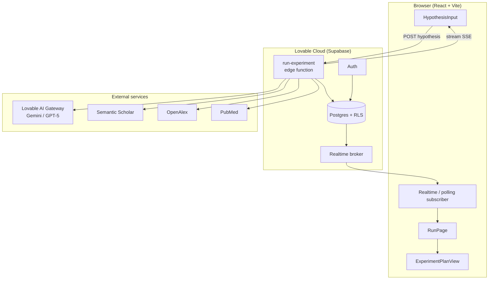
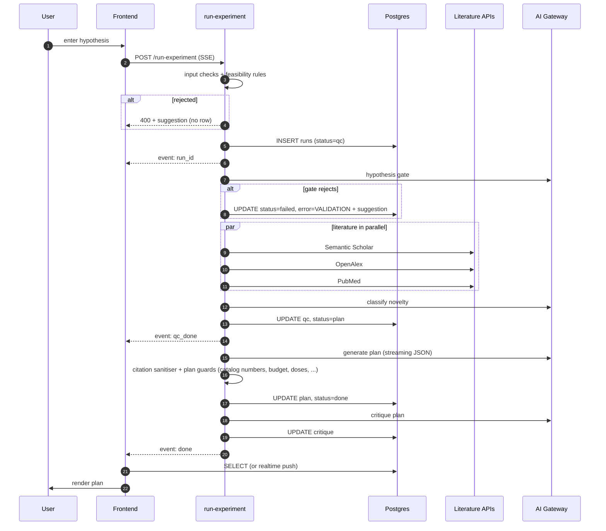
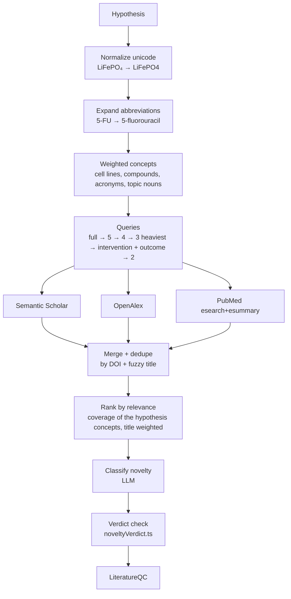
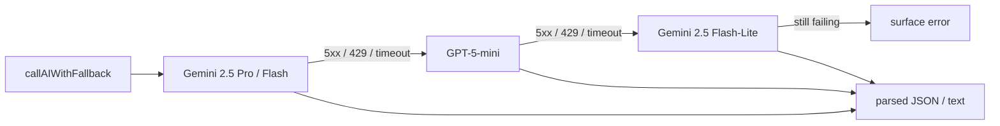
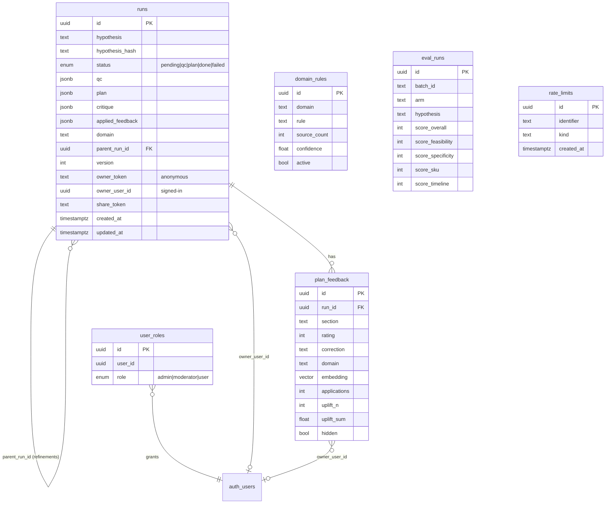
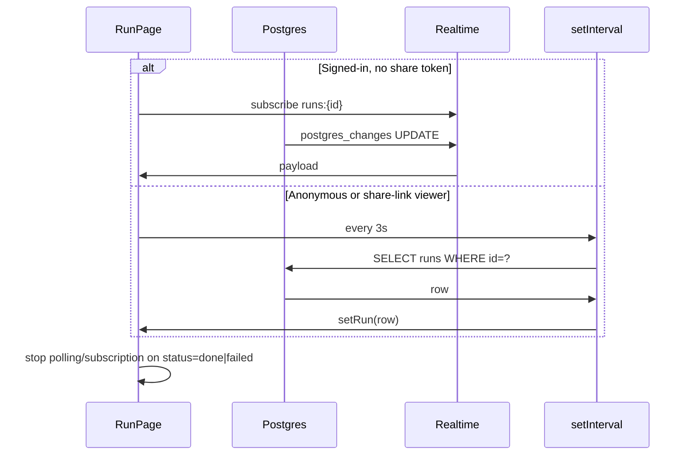
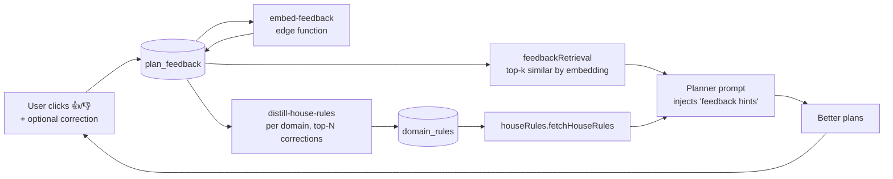
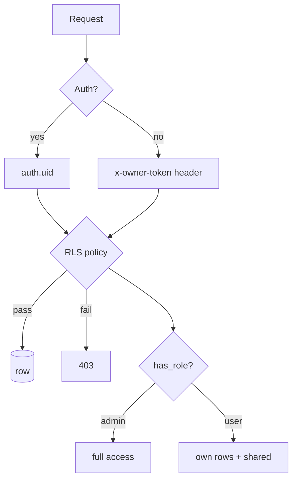

# Architecture

A deep technical walk-through of how **AI Scientist** turns a one-sentence
hypothesis into a fully-costed, peer-reviewed experiment plan: in about 60–90
seconds on the hosted Gemini / GPT-5 models it was built for; with the local
CPU-only model of the self-hosted setup a run takes tens of minutes (see
[RUNNING.md](../RUNNING.md), "Known limits").

This document is the reference for contributors. For a high-level overview, see
the [README](../README.md).

---

## Table of contents

1. [System overview](#1-system-overview)
2. [Request lifecycle](#2-request-lifecycle)
3. [Edge function pipeline](#3-edge-function-pipeline)
4. [Deterministic guards](#4-deterministic-guards)
5. [Literature search](#5-literature-search)
6. [LLM orchestration & fallback](#6-llm-orchestration--fallback)
7. [Data model](#7-data-model)
8. [Realtime & client sync](#8-realtime--client-sync)
9. [Feedback loop & house rules](#9-feedback-loop--house-rules)
10. [Security model](#10-security-model)
11. [Operational concerns](#11-operational-concerns)

---

## 1. System overview

Three layers, one tenant per request:

| Layer | Tech | Responsibility |
|---|---|---|
| **Client** | React 18, Vite 5, Tailwind, shadcn/ui | Input UX, streaming progress, plan rendering, share/PDF export |
| **Edge** | Deno on Supabase Functions | Orchestration, deterministic guards, LLM calls, persistence |
| **Data** | Postgres 14 + Realtime + RLS | Run state, plans, feedback, distilled rules, auth |

Everything outside the LLM is deterministic — that's the point.

---

## 2. Request lifecycle

A single hypothesis → plan flow, end-to-end:

**Notes**
- Only the cheap checks run *before* the row is inserted: length and format
  (`hypothesisValidation.ts`) and the feasibility rules (`feasibilityCheck.ts`);
  they answer `400` with a suggestion and cost no row. The LLM hypothesis gate
  runs *after* the insert, inside the background pipeline, so the user is
  already on the run page: a rejection is stored as a failed run with
  `VALIDATION` and the gate's suggestion (`runErrors.ts` shows it).
- The SSE stream emits `run_id` early so the client can navigate to `/run/:id` and switch to realtime.
- Critique runs as a **second independent LLM call** so it cannot rubber-stamp its own plan.

---

## 3. Edge function pipeline

```mermaid
flowchart LR
  IN[Hypothesis] --> G2{Feasibility<br/>regex rules}
  G2 -- violates --> OUT_R[400 + suggestion<br/>no row]
  G2 -- pass --> INS[(INSERT runs<br/>status=qc)]
  INS --> G1{LLM hypothesis<br/>gate}
  G1 -- reject --> FAIL[(run failed:<br/>VALIDATION + suggestion)]
  G1 -- pass --> LIT[Parallel literature<br/>3 sources × weighted keyword queries]
  LIT --> RANK[Relevance rank<br/>coverage of the hypothesis concepts]
  RANK --> NOV[Novelty classifier<br/>+ verdict check + canonical override]
  NOV --> QC[(UPDATE qc<br/>status=plan)]
  QC --> PROMPT[Build planner prompt<br/>+ safety flags + house rules + feedback hints]
  PROMPT --> PLAN[LLM plan<br/>streaming JSON]
  PLAN --> CIT[Citation sanitiser]
  CIT --> SKU[Live Sigma SKU lookup<br/>PubChem]
  SKU --> PG[Plan guards<br/>sources, catalog numbers, budget,<br/>materials, doses, steps, limits]
  PG -- high-severity finding --> REP[One repair attempt]
  REP --> PG2[Plan guards on the repair]
  PG --> SAVE[(UPDATE plan<br/>status=done)]
  PG2 --> SAVE
  SAVE --> CRIT[LLM critique<br/>independent call]
  CRIT --> CR[(UPDATE critique)]
```

Each box is a function in `supabase/functions/_shared/` or
`supabase/functions/run-experiment/`. The pipeline is straight-line — no
branching loops — so failures are easy to attribute.

---

## 4. Deterministic guards

The guards that keep the model honest. All are pure TypeScript; all run
**outside** the LLM so they can't be argued with. The first three run before
the planner; the rest check the plan it returns.

| Guard | File | What it catches |
|---|---|---|
| **Hypothesis gate** | `_shared/hypothesisGate.ts` | "hi", "write me a poem", off-topic chatter, vague research goals. Fails open on AI errors. |
| **Feasibility check** | `_shared/feasibilityCheck.ts` | Sub-Abbe optical resolution, FTL signaling, perpetual motion, etc. Pure regex rules. |
| **Safety screen** | `_shared/safety.ts` | Dual-use bio, controlled substances, human-subjects red flags. It does not block: the flags go into the planner prompt so the safety section addresses them. |
| **Catalog numbers** | `_shared/catalogCheck.ts` + `skuVerify.ts` + `planContentChecks.ts` | Supplier catalog-number formats and a canonical SKU dictionary (Sigma, Thermo, NEB, IDT, Qiagen, Promega, Bio-Rad, ATCC); up to three Sigma-Aldrich SKUs per plan are also looked up live in PubChem's Sigma-Aldrich deposits. A number that belongs to another product (Metformin "T9531" is trehalose; HepG2 "CRL-3216" is HEK293T) or breaks the supplier's format is removed before the plan is saved, and the material's notes say so ("Fixed" finding `catalog_numbers_removed`). The planner prompt no longer shows example SKUs (the small model copied them). |
| **Citation sanitiser** | `_shared/citations.ts` | Normalises inline citations to `[N]` and drops any `[N]` that is not an index into the references retrieved for *this* run. |
| **Source check** | `_shared/planIntegrity.ts` | Each protocol step's `source` must resolve to a retrieved reference (by `[N]`, URL, DOI or a title of 20+ characters) and is then shown as `[N] title (year)`; a source that cites anything else (URL, DOI, PMID, "et al.", a year) is removed, and so are such links inside step text. Short plain labels ("manufacturer's instructions") stay. The frontend re-applies it to plans saved before 9 Nov 2026. |
| **Budget arithmetic** | `_shared/planIntegrity.ts` | A reagents/materials line below the materials table subtotal is raised to the subtotal (`materials_line_corrected`), then `budget.total_usd` is set to the sum of `budget.line_items` (`budget_total_corrected`). A materials line far above the table is flagged (it may pay for unlisted items). |
| **Plan guards** | `_shared/planGuards.ts`, `planContentChecks.ts` | Flags (high severity, one automatic repair attempt): materials that do not name at least 40% of the weight of the hypothesis' anchor concepts (cell line, compound, named measurands; `hypothesisTerms.ts`), a protocol dose that differs from the hypothesis' dose by more than 1.5× (stock solutions excepted), protocol steps that are only material lists, and refinements whose numeric limit (budget cap, "cut by N%", timeline in days/weeks/months) the new plan breaks. Medium: materials that match cost-catalog items from topic groups the hypothesis does not mention, protocol steps longer than the timeline. Before the plan: house rules that share no specific term with the hypothesis are dropped (generic rules stay), the cost catalog shows only the topic groups that fit (`costCatalogPrompt`), and a refinement gets a digest of every section of the previous plan plus its limits as hard constraints. |
| **Novelty verdict check** | `_shared/noveltyVerdict.ts` | Holds the LLM classifier to the retrieved papers: "not found" with a candidate that covers at least 35% of the hypothesis becomes "similar"; "exact match" needs a candidate naming at least 85% of the anchor concepts, otherwise it becomes "similar" (or "not found" when nothing is on-topic); the overlap label follows the verdict; off-topic picks are not shown as references. |
| **Canonical-technique override** | `_shared/canonicalTechniques.ts` | Promotes textbook protocol requests (PCR, Western, ELISA, OD600 growth curves) to `exact_match`, with disqualifiers for non-canonical perturbations (CRISPRi, knockouts, Δ-strains). It does not fire when the technique is only the readout of a claim ("... will reduce X, measured by Western blot") or the comparator of something new ("a biosensor ... matching ELISA sensitivity"). |

If a pre-planner guard rejects, the run never reaches the planner — saving
tokens and preventing nonsense from ever being persisted. The post-plan
guards fix what is mechanical (sources, catalog numbers, the materials line, the total) and record the rest in
`plan.verification`, which the run page and the PDF show under "Automated
checks" and which the reviewer critique receives as high-severity
pre-check findings. Cached plans are re-checked before they are served, and
the corrections made when they were first saved are carried over to the copy.

---

## 5. Literature search

**Why three sources?** Each indexes the literature differently:

- **Semantic Scholar** — strong on CS / ML, broad coverage, citation graph
- **OpenAlex** — open data, abstracts via inverted index, good for materials
- **PubMed** — gold standard for biomed, MeSH-indexed

If any one returns 0, the others usually rescue the query. Each source tries
the queries in order and merges hits until it has 10: the full hypothesis,
then the 5, 4 and 3 heaviest concepts of the hypothesis
(`hypothesisTerms.ts`: alphanumeric names such as HepG2 weigh 3, compounds and
acronyms 2.5, topic nouns 2, cell types 1.5; words after "compared with" /
"matching" count 40%; "nicotinamide mononucleotide (NMN)" is one concept),
then the intervention and outcome without the cell line, then the 2 heaviest,
plus expanded-abbreviation forms. For the metformin / palmitate / HepG2
hypothesis that is "HepG2 metformin palmitate lipid" (it used to be "treating
hepg2 hepatocytes metformin hours"). The merged list keeps the 12 papers that
cover the hypothesis best; the run keeps up to 8 above a relevance floor of
0.2 (0.1 for canonical techniques).

The merge step de-dupes by DOI then by fuzzy title key (lowercased,
punctuation stripped, common stop-words removed).

---

## 6. LLM orchestration & fallback

Implemented in `_shared/ai-fallback.ts` + `_shared/fetch-with-retry.ts`.

Per-stage budgets:

Per-stage budgets on the hosted models (the code's defaults). Every timeout
is raised to at least `AI_MIN_TIMEOUT_MS`, which the self-hosted setup sets to
60 minutes because a CPU-only local model needs that long:

| Stage | Model preference | Timeout (hosted) |
|---|---|---|
| Hypothesis gate | flash / flash-lite | 6 s |
| Novelty classification | flash | 20 s |
| Plan generation (streaming) | gemini-2.5-pro → gpt-5-mini → flash | 90 s |
| Critique | gpt-5-mini → gemini-2.5-pro | 20 s |
| House-rule distillation | gpt-5-mini | 60 s |

**Why streaming for plan?** A full plan JSON is 6–12 KB. Streaming lets us
render the SSE progress UI and catch oversize payloads early.

**Why two independent calls (plan + critique)?** A model asked to grade its
own work will rubber-stamp it. The critique uses a *different model family*
when possible, with no access to the planner's chain-of-thought.

---

## 7. Data model

**Key invariants**

- `runs.parent_run_id` forms a tree per hypothesis — refinements bump `version`.
- `runs.status` is a state machine: `pending → qc → plan → done | failed`.
- `plan_feedback.embedding` (pgvector) powers similarity retrieval for "feedback hints" injected into future planner prompts.
- `domain_rules` are *distilled* from clusters of corrections — they're advisory data, not instructions, and the planner is told so to prevent prompt injection.

---

## 8. Realtime & client sync

The SSE stream from `run-experiment` closes right after the `run` event; the
pipeline continues in the background (`EdgeRuntime.waitUntil`). Live
progress therefore travels through the row itself: the function writes
`runs.progress` (`stage` = gate, literature, novelty, planning with
characters streamed and sections started, critique, complete) and the run
page renders it from the realtime / polling updates below.

**Why two paths?** The realtime RLS policy requires the
`x-owner-token` header, which Supabase Realtime doesn't forward. So we
restrict realtime to `auth.uid() IS NOT NULL && !shareToken` and fall back
to polling for everyone else. See `src/pages/RunPage.tsx`.

A stall watchdog flips a UI warning if `updated_at` hasn't moved in 150 s
(`STALL_THRESHOLD_MS` in `RunPage.tsx`; the pipeline bumps it every 20 s) —
edge functions occasionally exceed their wall-clock budget on Gemini 5xx
storms.

---

## 9. Feedback loop & house rules

Two retrieval paths feed every planner call:

1. **Per-hypothesis hints** — up to 5 feedback rows whose embedding is closest to the current hypothesis, above a cosine floor (`FEEDBACK_MIN_SIMILARITY`; code default 0.55, tuned for Gemini embeddings; 0.7 in the local env for nomic-embed-text).
2. **Per-domain house rules** — distilled wisdom from clustered corrections in the same domain, up to 8 per domain, of which only the rules that fit the hypothesis reach the prompt (`planGuards.filterRelevantRules`).

The Admin → Uplift panel tracks `uplift_sum / uplift_n` per lesson and
auto-demotes ones that drag scores down (`auto_demote_low_uplift_lessons`
RPC, triggered from the Admin page; the migrations schedule no nightly job
for it).

---

## 10. Security model

**Principles**

- **Roles in a separate table** — `user_roles` with a `SECURITY DEFINER` `has_role()` RPC. Never on `profiles`/`auth.users` (privilege-escalation risk).
- **Anonymous runs** — gated by an opaque random `owner_token` stored in `localStorage`; claimed into the user's account on sign-in via `claim_anonymous_runs` RPC, which also claims the anonymous feedback on those runs and clears the token. Token access (runs, feedback, realtime) applies only to rows no account owns, and a signed-in user's new runs and feedback store no token.
- **Server-only writes to runs** — clients have no INSERT, UPDATE or DELETE on `runs` except UPDATE of `share_token` (the owner's Share button). Plans, status, hashes and hypotheses are written only by the edge functions (service role), so no user can plant a plan in the shared cache. run-experiment also serves a cache entry only when its stored hypothesis hashes to the key.
- **Share links** — separate `share_token`, read-only, no realtime (see §8). The browser sends it as `x-share-token`, together with the viewer's own JWT when signed in (`createScopedClient({ asSignedInUser })`), so signed-in and signed-out recipients both see the run. Share-link viewers get no Refine or feedback buttons.
- **Feedback writes** — clients may INSERT only the typed columns of `plan_feedback` (`run_id`, `section`, `rating`, `correction`, `domain`, `hypothesis_excerpt`, owner columns) and UPDATE only `rating` and `correction` of their own rows; `hidden`, `dup_count`, the uplift counters, `embedding` and timestamps are server-written. Moderators hide and restore rows through `set_feedback_hidden()`, which checks the role (migration `20261110090000`). Editing a correction clears its embedding in a trigger.
- **Server-only RPCs** — `match_plan_feedback` (returns other users' corrections and hypothesis excerpts), `find_duplicate_feedback`, `bump_feedback_dup`, `cleanup_stale_runs`, `cleanup_old_rate_limits` are executable by `service_role` only; the edge functions call them with the service-role client and pg_cron runs as `postgres`. The moderator RPCs and `has_role` are not executable with the anon key. Supabase grants EXECUTE on new functions in `public` to `anon` and `authenticated` directly, so a `REVOKE ... FROM public` alone does not remove it.
- **Rate limiting** — `rate_limits` table + `cleanup_old_rate_limits` cron. Per-IP and per-user buckets enforced in the edge function.
- **No service-role key in the browser.** Ever.
- **Edge functions** validate JWT by default (`verify_jwt` left at default). `run-experiment`, `embed-feedback` and `backfill-feedback-embeddings` opt out because anonymous users call them, and check the caller themselves (`_shared/callerAuth.ts`): `embed-feedback` only for the row's owner (JWT, or the anonymous owner token for an unclaimed row), a moderator/admin or the service role; `backfill-feedback-embeddings` only for a moderator/admin or the service role.

---

## 11. Operational concerns

| Concern | Mechanism |
|---|---|
| **Stuck runs** | `cleanup_stale_runs` RPC (pg_cron, every 5 minutes) marks runs `failed` if `updated_at` is older than 20 minutes while still in `pending`/`qc`/`plan`. Running pipelines bump `updated_at` every 20 s. |
| **Cost catalog drift** | `_shared/costCatalog.ts` is checked in; updated by hand against supplier price lists, version-tagged. |
| **Eval harness** | `eval-harness` edge function replays a batch of canonical hypotheses against current code, scores via LLM judge, persists to `eval_runs`. Surfaced in Admin. |
| **Embeddings degraded mode** | With no embedding model configured (or the provider down), new feedback is stored with `embedding = null`, retrieval returns no past corrections (there is no lexical fallback) and the backfill function embeds pending rows later. Plans are generated as usual. |
| **Feedback dedup** | `find_duplicate_feedback` RPC + `bump_feedback_dup` collapses near-duplicate corrections (cosine ≥ 0.92, `embed-feedback`). A repeat by the same owner is dropped without bumping the earlier row, so `dup_count` counts distinct people. |
| **Linting RLS** | `bunx supabase db lint` + the in-tree `supabase--linter` flags missing policies on new tables. |
| **CI** | `.github/workflows/ci.yml` runs ESLint (blocking, 0 errors), Vitest, the production build, `deno test` and `deno check` of every function on every PR. |

---

## Where to look next

- **Adding a new deterministic guard** → `supabase/functions/_shared/` + wire it in `run-experiment/index.ts` before the planner call.
- **Adding a literature source** → implement `searchX(q, timeoutMs): Promise<LitPaper[]>` in `_shared/literature.ts` and add it to the `Promise.allSettled` array in `searchLiterature`.
- **Tuning novelty calibration** → edit `_shared/noveltyCalibration.ts` and run the nightly drift check.
- **Changing plan schema** → `_shared/plannerCore.ts` (`planSchema`); the planner is structured-output, so the schema *is* the contract.
- **New realtime channel** → must match the `runs:%` topic policy. See §8.

---

*Last updated: 2026-04. Maintained alongside the code — if this doc and the code disagree, fix the doc.*
